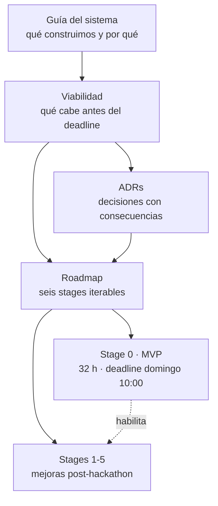

# Documentación — Trust

Caja negra auditable para agentes de IA. Este directorio separa **decisiones** (ADR) de **ejecución** (roadmap por stages).

## Documentos

| Documento | Qué contiene |
|---|---|
| [Guía del sistema](guia-del-sistema.md) | Arquitectura completa, protocolo anti-manipulación, pitch y rúbrica. |
| [Viabilidad](viabilidad.md) | Evaluación del scope contra el deadline real, premisas verificadas y recortes. |
| [ADRs](adr/) | Cada decisión de arquitectura con su contexto, alternativas y consecuencias. |
| [Roadmap](roadmaps/) | El plan completo en stages iterables. Stage 0 es el MVP con deadline. |

## Mapa de la documentación

## Cómo leer esto

1. Si vas a **escribir código hoy**, lee [Stage 0](roadmaps/stage-0-mvp-demo.md) y los ADRs 0006-0009.
2. Si vas a **defender el pitch**, lee la guía y los ADRs 0001-0004.
3. Si vas a **planificar después del hackathon**, lee el [roadmap completo](roadmaps/README.md).

## Convenciones

- Los ADRs son inmutables una vez aceptados. Un cambio de decisión crea un ADR nuevo que supersede al anterior.
- Los stages se cierran con su checklist de salida completo. No se abre el siguiente sin eso.
- Toda estimación es en horas de trabajo efectivo, no de reloj.
