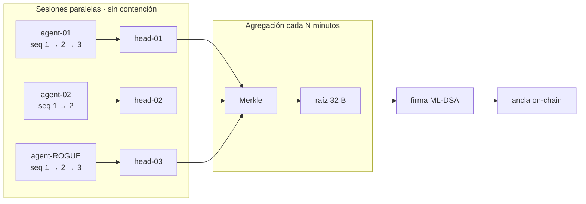

# ADR-0003 — Hash-chain por sesión y agregación Merkle global

- **Estado:** Aceptado
- **Fecha:** 2026-10-24
- **Stage:** 0

## Contexto

Sellar cada evento de forma global crea contención: todos los agentes compiten por un único escritor. A 100 eventos por segundo, eso es un cuello de botella y un punto único de fallo.

## Decisión

Dos niveles:

1. **Hash-chain por sesión:** cada evento encadena `seq` + `prev_hash` dentro de su sesión. Las sesiones son paralelas y no compiten entre sí.
2. **Agregación Merkle periódica:** cada N minutos se agregan las cabezas de todas las sesiones en una raíz única que se firma y se ancla.

`seq` detecta borrado (hueco); `prev_hash` detecta alteración (cadena rota).

## Flujo de sellado

## Consecuencias

**Positivas**
- El sellado escala horizontalmente: el trabajo global solo agrega cabezas.
- La detección es local y barata: no hace falta recomputar todo el histórico.

**Negativas**
- Un hueco de `seq` prueba que algo faltó, no cuál era su contenido.
- La ventana entre anclajes deja eventos recientes fuera de la última raíz; la UI debe mostrarlo.

## Alternativas descartadas

- **Una sola cadena global:** contención y punto único de fallo.
- **Sellado por evento on-chain:** costo y latencia inviables.
