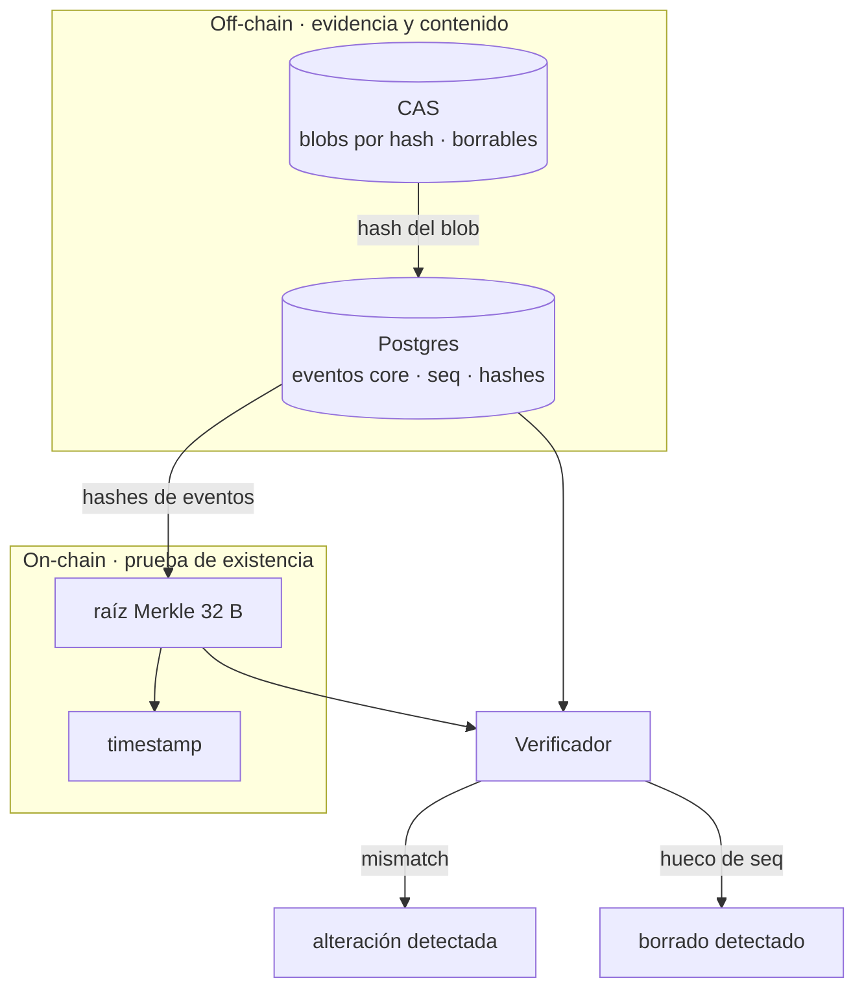

# ADR-0005 — Evidencia off-chain y WORM diferido a Stage 1

- **Estado:** Aceptado (MVP), revisado en Stage 1
- **Fecha:** 2026-10-24
- **Stage:** 0

## Contexto

Los blobs (prompts, outputs, contenido) son demasiado grandes para la cadena y pueden contener datos personales que deben poder borrarse.

## Decisión

La evidencia vive off-chain: Postgres para eventos core y un CAS para blobs, direccionado por hash.

- **En el MVP (Stage 0):** filesystem local más Postgres. El hash es la prueba; el storage es reemplazable.
- **En Stage 1:** reemplazar por S3/MinIO con Object Lock (WORM) y ciclo de vida hot → warm → cold.

## Qué vive dónde

## Consecuencias

**Positivas**
- La integridad no depende de la fe en el storage: depende de los hashes y del anclaje.
- Perder un blob no pierde la prueba: el hueco de `seq` sigue siendo evidencia.
- GDPR: se puede borrar el blob y conservar el hash on-chain.

**Negativas**
- En el MVP el WORM es una promesa de roadmap, no una garantía técnica. **El pitch debe decirlo así.**
- El CAS local no sobrevive a la pérdida del disco; la disponibilidad en el MVP es best-effort.

## Alternativas descartadas

- **Todo on-chain:** costo prohibitivo y contradice el derecho al olvido.
- **Solo Postgres:** sin CAS, los blobs grandes degradan la base y no hay deduplicación.
