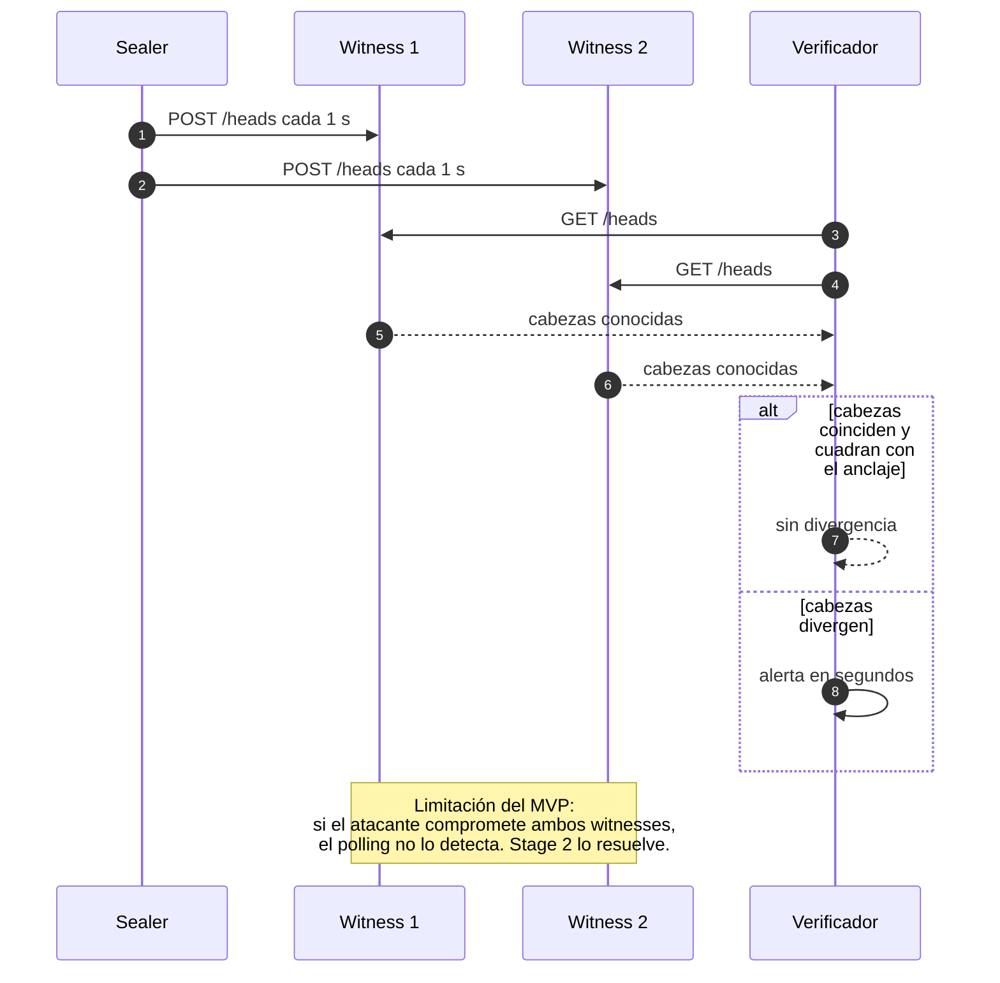

# ADR-0007 — Testigos por HTTP polling en el MVP

- **Estado:** Aceptado (MVP), revisado en Stage 2
- **Fecha:** 2026-10-24
- **Stage:** 0

## Contexto

La guía propone gossip entre testigos para detectar divergencia en segundos. Implementar gossip real (libp2p o similar) consume tiempo que el deadline no tiene.

## Decisión

En el MVP, dos o tres procesos witness independientes replican las **cabezas de sesión** mediante HTTP polling cada segundo. La UI muestra la comparación de cabezas.

**Importante:** los witnesses del MVP replican cabezas, no blobs. Pueden probar que un evento existió y cuándo, pero **no recuperar su contenido**. El guion del demo debe decir exactamente eso.

## Flujo de réplica y detección

## Consecuencias

**Positivas**
- Detecta divergencia de un escritor comprometido con una fracción del esfuerzo.
- Es suficiente para el gesto visual del demo.

**Negativas**
- HTTP polling no es gossip: hay un punto de coordinación y no hay propagación entre pares.
- Sin replicación de blobs, la recuperación de contenido tras un borrado no es posible en el MVP. Stage 2 lo resuelve.

## Alternativas descartadas

- **libp2p / gossip real:** Stage 2.
- **Un solo witness:** no hay mayoría ni comparación.
