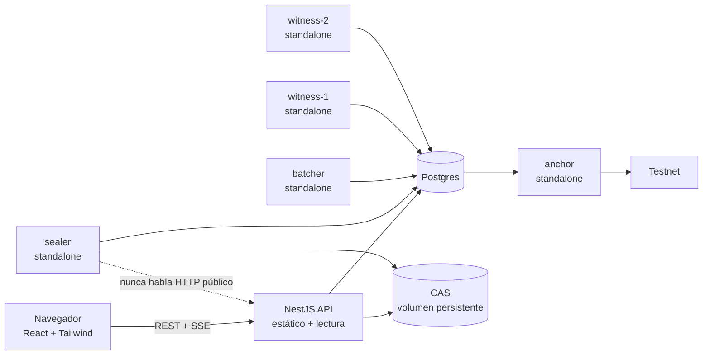

# ADR-0009 — Stack del MVP

- **Estado:** Aceptado
- **Fecha:** 2026-10-24
- **Stage:** 0
- **Supersede:** la versión "Propuesto" del mismo ADR

## Contexto

- El repo no tiene código y quedan 32 horas.
- El equipo domina **NestJS**. No ha trabajado con **Next.js**.
- La app se construye con asistencia de IA. Eso reduce el costo de escribir sintaxis, pero **no** el de depurar a las 3 AM.
- El sistema necesita daemons de larga vida y una trust zone que no hable HTTP con el mundo.

## Decisión

| Capa | Elección | Razón |
|---|---|---|
| Frontend | **Vite + React + Tailwind** | Cero magia, build estático, el terreno donde los LLMs alucinan menos |
| API de lectura | **NestJS** | El equipo lo domina; sirve el estático con `@nestjs/serve-static` |
| Daemons | **Nest standalone** (`createApplicationContext`) | Mismos patrones sin abrir puertos |
| Núcleo cripto | **TypeScript puro** en `packages/core` | Sin DI ni decoradores; testeable y auditable aislado |
| Store | **Postgres** | Eventos core, `seq`, hashes |
| Blobs | **Filesystem (CAS por hash)** | WORM real en Stage 1 |
| Chain | **viem** + contrato mínimo | Cliente RPC maduro |
| Firma PQ | **@noble/post-quantum** | Demo-grade, sin dependencias nativas |
| Streaming | **SSE con `@Sse()`** | Flujo unidireccional, reconexión nativa, sin protocolo propio |
| Deploy | **Un host + Postgres gestionado** | Una URL, cero CORS, una superficie de fallo |

### Topología

## Consecuencias

**Positivas**
- Un solo lenguaje y un solo deploy: una URL, cero CORS, un `Dockerfile`.
- El equipo depura con patrones que ya conoce, no aprende un framework bajo presión.
- `packages/core` se testea sin levantar Nest.
- Los daemons no exponen puertos; la llave de firma queda lejos del HTTP público.

**Negativas**
- NestJS añade peso de framework a procesos que son loops. Se acepta a cambio de familiaridad y consistencia.
- Un solo host es un punto único de fallo en el demo. Se mitiga con video de respaldo.
- Vite no da SSR. No se necesita: dashboard interno y página de verificación interactiva.

## Alternativas descartadas

- **Next.js:** App Router y server components añaden una curva que el equipo no tiene; los LLMs alucinan con más frecuencia en ese modelo; y el deploy unificado que ofrece se replica con `ServeStatic`. No hay SEO ni SSR que justifiquen la curva.
- **Vercel + serverless:** no corre daemons. El sealer, el batcher y el anchor necesitan procesos persistentes.
- **NestJS sirviendo los workers por HTTP:** abre puertos innecesarios hacia la trust zone. Se usa `createApplicationContext`.

## Deploy

1. **Mirror a repo personal.** Vercel y Render no pueden acceder al repo de la organización.
2. **Dockerfile multi-stage:** build de Vite → build de Nest → imagen de runtime.
3. **`start.sh`** lanza API, sealer, batcher, anchor y dos witnesses como procesos separados dentro del mismo contenedor.
4. **Postgres gestionado** con `DATABASE_URL`.
5. **Variables:** `DATABASE_URL`, `RPC_URL`, `PRIVATE_KEY`, `TELEGRAM_TOKEN`, `TELEGRAM_CHAT_ID`, `CONTRACT_ADDRESS`.
6. **Healthcheck** en `/health` para el proveedor.
7. **Contrato desplegado una vez**; la dirección va en variable de entorno.
8. **Video de respaldo** grabado antes del feature freeze.

## Gotchas

- SSE: no inyectar `@Res()`; excluir la ruta de la compresión; enviar `: ping` cada 15-20 s.
- `@nestjs/serve-static` debe excluir `/api` y `/events` del fallback a `index.html`.
- El build de Vite sale a `apps/web/dist` y se sirve con `serveRoot: '/'`.
- Todos los daemons comparten imagen y cambian solo el comando de arranque.
- Si el contenedor cae, caen todos los procesos. Aceptable para el demo, no para producción.
