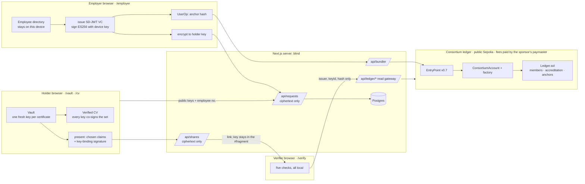

# Constancia — Shared contracts

The single source of truth for every interface between agents. **A1-S0 commits these as typed stubs
before anyone else starts.** Change a contract only by editing this file and the stub in the same
commit, and tell the team in chat. Every module listed here has exactly one owner (see the README
ownership map). Others import it; they never edit it.

---

## 1. Architecture in one picture



**The six flows**

1. **Accreditation.** HR creates a device key in the browser → its counterfactual smart account is the
   employer's identity → `applyForAccreditation(name)` → consortium members approve until `quorum` →
   status `ACTIVE`. Issuing stays locked until then.
2. **Request.** The holder opens a vault, generates a **fresh key pair per request** (sign key for
   holder binding, ECDH key for delivery) and posts the two public keys, the employer and an opaque
   employee number. No name, no claims.
3. **Issue.** HR opens the request, picks the employee from the local directory, the browser builds
   the SD-JWT VC, signs it with a device key, anchors `sha256(issuer JWT)` on the ledger (UserOp, fee
   paid by the consortium's sponsor), encrypts the credential to the holder's ECDH key and posts the ciphertext. The server never
   sees a claim.
4. **Share.** The holder picks which claims a reader may see, signs a key-binding JWT, encrypts the
   result with a random key and stores the ciphertext on the server. The link is
   `/verify#s=<id>.<key>`: the key lives in the fragment and never reaches the server.
5. **Verify.** The verifier's browser decrypts, runs five checks locally. Only
   `{ issuer, keyId, credentialHash }` goes to the ledger gateway.
6. **Join.** `/cv` verifies every attached certificate, builds a timeline, and seals the chosen set
   into one Verified CV: each certificate's own key signs the hash of the whole set.

**Decisions vs. the previous design.** Trust root = consortium accreditation recorded on a
public Sepolia contract (replaces `did:web` and the institution's domain). Account abstraction with
P-256 device keys replaces Privy; gas is real but invisible — one sponsor wallet pays every fee
through our verifying paymaster. SD-JWT replaces the plain JWT. The PDF seal is gone; a printable
letter is a stretch goal.

---

## 2. Folder layout and owners

```
contracts/{ConsortiumAccount,AccountFactory,VerifyingPaymaster,Ledger}.sol, contracts/vendor/, contracts/test/   A3
scripts/chain/{compile,identities,deploy,deposit,seed,smoke,status}.ts      A3
scripts/check-demo.ts                             A3
prisma/schema.prisma, prisma.config.ts            A4
public/contexts/constancia-v1.jsonld              A2
public/demo/sample.json                           A3   synthetic sample credential + its holder key (published on purpose, for the Lab)
src/app/layout.tsx, globals.css, page.tsx         A1   landing at /
src/app/_landing/                                 A1
src/app/ledger/**                                 A1   /ledger (public network page) and /ledger/operator
src/app/dev/kit/                                  A1   design kit page
src/app/dev/identity/                             A3   dev tool: import demo identities into this browser
src/app/employer/**                               A4
src/app/vault/**, src/app/cv/**                   A5
src/app/verify/page.tsx, _components/, _lib/      A2   /verify
src/app/verify/lab/**                             A5   /verify/lab
src/app/api/auth/**, api/requests/**,
  api/employer/**, api/shares/**                  A4
src/app/api/bundler/route.ts, api/ledger/**,
  api/did/**, api/dev/**                          A3
src/components/ui/                                A1   primitives everyone uses
src/lib/env.ts, handoff.ts                        A1
src/lib/credential/                               A2   keys, keystore, sdjwt, present, share-crypto, verify, passport, attacks
src/lib/ledger/                                   A3   types, memory, chain, reader, account-client, userop, format, gateway-client
src/lib/server/                                   A4   db.ts, session.ts, rate-limit.ts
src/lib/employer/                                 A4   directory store, issue orchestration
src/lib/vault/                                    A5   vault store, requests client, shares client
src/generated/prisma/                             generated, gitignored
```

---

## 3. Identifiers and formats

| Thing | Format | Example |
| --- | --- | --- |
| `Hex` | `` `0x${string}` `` lowercase | `0x7f3a…` |
| `Address` | `0x` + 40 hex, lowercase | `0x1f9a…` |
| Chain ID | `11155111` (Sepolia, public testnet) | |
| Employer / member account | the `ConsortiumAccount` address | `0x1f9a…` |
| Issuer DID | `did:constancia:<chainId>:<account>` | `did:constancia:11155111:0x1f9a…` |
| `keyId` | `keccak256(x ‖ y)` of the P-256 public key, x and y as 32-byte big-endian | `0x9c…` |
| JWS `kid` | `<did>#<keyId>` | `did:constancia:11155111:0x1f9a…#0x9c…` |
| `P256Jwk` | `{ kty:'EC', crv:'P-256', x, y }` base64url 32-byte coordinates | |
| `EcdhJwk` | same shape, used only for delivery encryption | |
| Credential hash | `0x` + `sha256(utf8(issuerJwt))` where `issuerJwt` is the compact JWS before the first `~` | `0x4be1…` |
| Request ID, Share ID | 128 random bits, 32 hex chars. The ID is the only secret needed to poll or fetch | |
| Employee number | opaque string ≤ 40 chars, typed by the holder, meaningful only to the employer | `E-1042` |

**DID method `did:constancia` (10 lines, because we resolve it ourselves).** Method-specific id is
`<chainId>:<account>`. Resolution reads the account's owner keys from the ledger and returns a W3C DID
document with one `JsonWebKey2020` verification method per key whose `removedAt` is null, listed in
`assertionMethod`, plus `didDocumentMetadata: { accredited, name }` from the registry. Removed keys are
kept in the ledger history so older credentials stay verifiable; they are just not in the document.

---

## 4. Credential (A2 owns `src/lib/credential/`)

### 4.1 Types: `src/lib/credential/types.ts`

```ts
export type Hex = `0x${string}`;
export type Address = Hex;
export interface P256Jwk { kty: 'EC'; crv: 'P-256'; x: string; y: string }
export type EcdhJwk = P256Jwk;
export interface P256PrivateJwk extends P256Jwk { d: string }

/** Lives only in the employer's browser, then in the holder's vault. Never sent to a server. */
export interface EmploymentRecord {
  givenName: string;                  // "María Fernanda"
  familyName: string;                 // "Rojas"
  nationalId: string;                 // "V-24.567.890"
  jobTitle: string;                   // "Logistics Analyst"
  department?: string;
  employmentType: 'FULL_TIME' | 'PART_TIME' | 'CONTRACT';
  startDate: string;                  // ISO date, not in the future
  endDate?: string;                   // ISO date >= startDate. Absent = currently employed
  workCountry: string;                // ISO 3166-1 alpha-2, "VE"
  salaryMonthlyUsd?: number;          // integer, 0..1_000_000
}

/** The twelve selectively disclosable claims. camelCase because the VC is JSON-LD shaped. */
export type ClaimName =
  | 'givenName' | 'familyName' | 'nationalId'
  | 'jobTitle' | 'department' | 'employmentType'
  | 'startDate' | 'endDate' | 'employedNow' | 'workCountry'
  | 'salaryMonthlyUsd' | 'salaryBand';
export type DisclosedClaims = Partial<Record<ClaimName, string | number | boolean>>;
```

Derived claims, computed by `issueCredential`:
`employedNow = endDate === undefined` (true as of `validFrom`); `salaryBand` from
`salaryMonthlyUsd` using the bands `"<300" "300-600" "600-1000" "1000-2000" "2000+"` (USD/month).
`salaryBand` exists so a holder can prove an income range without the exact figure.

`employmentRecordSchema` (zod 4) lives next to the types and is used by the employer form.
Names 1–80, nationalId 3–32, jobTitle 2–100, department ≤ 80, dates ISO, `startDate` and `endDate` not
in the future, `endDate >= startDate`.

### 4.2 The credential: W3C VC Data Model 2.0 secured with SD-JWT

The payload *is* the VC (the VC-JOSE-COSE way), and the claims about the person sit under
`credentialSubject`, each one hidden behind a salted hash.

Header: `{ "alg": "ES256", "typ": "vc+sd-jwt", "cty": "vc", "kid": "<did>#<keyId>" }`.

```json
{
  "@context": ["https://www.w3.org/ns/credentials/v2", "<APP_URL>/contexts/constancia-v1.jsonld"],
  "type": ["VerifiableCredential", "EmploymentCredential"],
  "issuer": "did:constancia:11155111:0x1f9a…",
  "validFrom": "2026-10-24T20:00:00Z",
  "validUntil": "2027-01-22T20:00:00Z",
  "credentialSubject": { "type": "Employee", "_sd": ["<12 digests, sorted>"] },
  "iss": "did:constancia:11155111:0x1f9a…",
  "iat": 1792872000,
  "exp": 1800648000,
  "cnf": { "jwk": { "kty": "EC", "crv": "P-256", "x": "…", "y": "…" } },
  "_sd_alg": "sha-256"
}
```

- `validUntil`/`exp`: `issuedAt + 90 days` when the employee is currently employed; absent for an
  ended employment (a past fact does not expire).
- `cnf.jwk` is the holder's **per-certificate** sign key from the request.
- Always visible to anyone holding the issuer JWT: `issuer`, dates, `type`, `cnf`, `@context`. The
  employer's name is **not** in the credential: the verifier shows the name the consortium registered.
- SD-JWT mechanics (RFC-exact; hand-roll if the library does not give them):
  disclosure = `base64url(JSON([salt, claimName, value]))` with a 128-bit random salt;
  digest = `base64url(sha256(ASCII(disclosure)))`; `_sd` sorted by digest; issuance form is
  `<issuerJwt>~<D1>~…~<Dn>~`; presentation form is `<issuerJwt>~<chosen Di>~<kbJwt>`.
- Size: issuer JWT ≤ 3 KB, full SD-JWT ≤ 6 KB. Assert in tests.
- **Selective disclosure, not zero-knowledge proofs.** A hidden claim is a salted hash: the verifier
  learns nothing about its value. There are no predicate proofs ("salary above X"); `salaryBand` and
  `employedNow` are issued as separate claims for exactly that reason.

### 4.3 Presentation and key binding

KB-JWT header `{ alg: 'ES256', typ: 'kb+jwt' }`, signed by the holder's per-certificate key.
Payload `{ iat, exp, aud, nonce, sd_hash, cv_set? }`:

- `sd_hash = base64url(sha256(ASCII("<issuerJwt>~<chosen disclosures>~")))`, the presentation string
  up to and including the last `~` before the KB-JWT.
- `aud`: a label the holder types ("Banco Demo"). `nonce`: 16 random bytes, base64url.
  `exp`: `iat + ttl` (1 h, 24 h or 7 d).
- `cv_set`: present only inside a Verified CV (4.4).
- **Replay limit (documented, not hidden):** a leaked share link can be replayed until `exp`. A
  verifier-chosen nonce (challenge mode) removes it and is a stretch goal.

Reveal templates (`REVEAL_TEMPLATES`, the holder can toggle every claim after picking one):

| Template | Claims |
| --- | --- |
| `employment` | `employedNow`, `startDate`, `endDate`, `workCountry` |
| `income` | `employment` + `salaryBand` |
| `role` | `employment` + `jobTitle`, `department`, `employmentType` |
| `identity` | `givenName`, `familyName`, `nationalId` |
| `full` | all twelve |

### 4.4 Verified CV (the join)

A file or share payload:

```json
{ "type": "constancia-cv", "v": 1, "presentations": ["<jwt>~<d>~<kb>", "<jwt>~<d>~<d>~<kb>", "…"] }
```

Every presentation is a normal one (4.3) with the same `aud` and `nonce`, **plus**
`cv_set = base64url(sha256(utf8(sortedSdHashes.join('~'))))`, where `sortedSdHashes` are the
`sd_hash` of every presentation in the file. Each presentation's own holder key signs it, so:

- you cannot splice another person's certificate in (its key never signed this `cv_set`);
- you cannot drop or swap an entry after sealing (every other signature would stop matching);
- all entries having been signed in one go shows one party controlled every key at that moment, with
  no name needed;
- different certificates use different keys, so two verifiers cannot link a person from the key.

The timeline (`buildTimeline`) is derived from the disclosed `startDate`, `endDate`, `employedNow`
and `jobTitle`, and flags gaps over 1 month and overlaps.

### 4.5 Public functions

```ts
// keys.ts: isomorphic
export interface Es256Signer { keyId: Hex; jwk: P256Jwk; sign(message: Uint8Array): Promise<Uint8Array> /* 64-byte r||s, hashes with SHA-256 */ }
export function generateSigner(opts?: { extractable?: boolean }): Promise<{ signer: Es256Signer; privateKey: CryptoKey }>;
export function signerFromPrivateJwk(jwk: P256PrivateJwk, opts?: { extractable?: boolean }): Promise<Es256Signer>;
export function keyIdOf(jwk: P256Jwk): Hex;
export function verifyEs256(jwk: P256Jwk, message: Uint8Array, signature: Uint8Array): Promise<boolean>;

// keystore.ts: browser only, IndexedDB, non-extractable keys survive reloads
export function createStoredSigner(name: string): Promise<Es256Signer>;
export function loadSigner(name: string): Promise<Es256Signer | null>;
export function importStoredSigner(name: string, jwk: P256PrivateJwk): Promise<Es256Signer>;
export function listSignerNames(): Promise<string[]>;

// sdjwt.ts
export interface IssuedCredential {
  sdJwt: string;                 // issuance form, all disclosures
  issuerJwt: string;
  credentialHash: Hex;
  did: string; account: Address; keyId: Hex;
  validUntil: string | null;
  claims: DisclosedClaims;       // everything, for the holder's own screen
}
export function issueCredential(args: {
  record: EmploymentRecord;
  issuer: { did: string; keyId: Hex };
  signer: Es256Signer;
  holderJwk: P256Jwk;
  appUrl: string;
  now?: Date;
}): Promise<IssuedCredential>;
export function credentialHashOf(issuerJwt: string): Hex;

// present.ts
export const REVEAL_TEMPLATES: Record<'employment' | 'income' | 'role' | 'identity' | 'full', ClaimName[]>;
export function presentCredential(args: {
  credential: string;            // issuance form
  holder: Es256Signer;
  reveal: ClaimName[];
  aud: string; ttlSec: number; nonce?: string; now?: Date; cvSet?: string;
}): Promise<string>;
export interface DecodedPresentation {
  issuerJwt: string; header: Record<string, unknown>; payload: Record<string, unknown>;
  claims: DisclosedClaims;                 // only what the presentation discloses
  hiddenCount: number;                     // digests in _sd that no disclosure matched
  sdHash: string;                          // base64url sha256 of "<issuerJwt>~<disclosures>~"
  keyBinding: { jwt: string; header: Record<string, unknown>; payload: Record<string, unknown> } | null;
}
export class TokenError extends Error {}   // message is a human sentence, shown as the TOKEN failure
export function decodePresentation(s: string): DecodedPresentation;   // throws TokenError

// share-crypto.ts
export function generateEncKey(): Promise<{ privateKey: CryptoKey; jwk: EcdhJwk }>;       // non-extractable ECDH P-256
export function encryptForHolder(plaintext: string, jwk: EcdhJwk): Promise<string>;        // JWE ECDH-ES + A256GCM
export function decryptFromIssuer(jwe: string, privateKey: CryptoKey): Promise<string>;
export function sealShare(plaintext: string): Promise<{ ciphertext: string; key: string }>; // JWE dir + A256GCM; key base64url
export function openShare(ciphertext: string, key: string): Promise<string>;

// verify.ts
export interface VerifyContext { lookup: LookupFn; expectNonce?: string; requireKeyBinding?: boolean /* default true */; maxSkewSec?: number /* default 300 */ }
export function verifyPresentation(input: string, ctx: VerifyContext): AsyncGenerator<CheckEvent, Verdict>;
export function verifyCertificate(sdJwt: string, ctx: Omit<VerifyContext, 'requireKeyBinding'>): AsyncGenerator<CheckEvent, Verdict>; // no KB: vault, CV portal

// passport.ts
export function buildVerifiedCv(args: {
  items: { credential: string; holder: Es256Signer; reveal: ClaimName[] }[];
  aud: string; ttlSec: number; now?: Date;
}): Promise<string>;                                                       // the JSON above
export function verifyVerifiedCv(input: string, ctx: VerifyContext): AsyncGenerator<CvEvent, CvVerdict>;
export interface TimelineInput { id: string; employer: string; jobTitle?: string; startDate?: string; endDate?: string; employedNow?: boolean }
export interface CareerTimeline {                     // data; the UI component is `Timeline` in components/ui
  items: (TimelineInput & { datesHidden: boolean })[];  // sorted by startDate, dates-hidden entries last
  gaps: { from: string; to: string; months: number }[];     // > 1 month
  overlaps: { a: string; b: string }[];                     // ids
}
export function buildTimeline(entries: TimelineInput[]): CareerTimeline;

// attacks.ts: the Fake Letter Lab
export type AttackId = 'edit-claim' | 'forge-signature' | 'fake-employer' | 'stolen-certificate';
export interface Attack { id: AttackId; title: string; changed: string; expectedFailure: CheckCode }
export interface Sample { credential: string; holderJwk: P256PrivateJwk }          // public/demo/sample.json
export function runAttack(id: AttackId, sample: Sample): Promise<{ presentation: string; attack: Attack }>;
```

The attacks and where each must stop: `edit-claim` rewrites a disclosed value → **TOKEN**;
`forge-signature` re-signs the issuer JWT with a fresh key and keeps the employer's `kid` →
**SIGNATURE**; `fake-employer` builds a perfectly valid credential from a brand-new, never-accredited
account → **ISSUER**; `stolen-certificate` replaces the key-binding JWT with one signed by the
attacker's key → **HOLDER**. The fifth check, **LEDGER**, is shown live: the employer revokes in
`/employer/issued` and the verifier's "Check again" turns red.

### 4.6 Verification events (drive the verifier UI)

```ts
export type CheckCode = 'TOKEN' | 'ISSUER' | 'SIGNATURE' | 'HOLDER' | 'LEDGER';
export type CheckStatus = 'PENDING' | 'CHECKING' | 'VERIFIED' | 'FAILED' | 'UNAVAILABLE' | 'NOT_EXAMINED';

export interface CheckEvent {
  index: 1 | 2 | 3 | 4 | 5;   // TOKEN=1 ISSUER=2 SIGNATURE=3 HOLDER=4 LEDGER=5
  code: CheckCode;
  status: CheckStatus;
  measured?: string;          // "1,842 bytes · 7 hidden" · "Empresa Demo A" · "ES256 · 1.1 ms" · "key 0x9c… · bound" · "block 1,204"
  detail?: string;            // one human sentence
  elapsedMs?: number;
}

export type Verdict =
  | { kind: 'AUTHENTIC'; claims: DisclosedClaims; hiddenCount: number;
      issuer: { did: string; account: Address; name: string }; record: RecordInfo;
      keyBound: boolean; validUntil: string | null }
  | { kind: 'NOT_AUTHENTIC'; failedAt: CheckCode; reason: string }
  | { kind: 'UNAVAILABLE'; failedAt: 'ISSUER' | 'LEDGER'; reason: string };   // ledger gateway unreachable

export type LookupFn = (req: LookupRequest) => Promise<LookupResponse>;   // types from §6; the verifier injects lookupLedger

export type CvEvent = CheckEvent & { entry: number };       // 0-based entry
export type CvVerdict =
  | { kind: 'AUTHENTIC'; entries: Extract<Verdict, { kind: 'AUTHENTIC' }>[]; timeline: CareerTimeline }
  | { kind: 'NOT_AUTHENTIC'; failedEntry: number | null; failedAt: CheckCode; reason: string }
  | { kind: 'UNAVAILABLE'; reason: string };
```

Order is fixed and the pipeline stops at the first failure, emitting `NOT_EXAMINED` for the rest.

1. **TOKEN**: parse; every disclosure's digest is in a reachable `_sd`; `typ`, `cty`, `@context[0]`
   and `type` are right; the DID's chain ID is ours. Counts the hidden claims.
2. **ISSUER**: one `lookup`. Issuer status must be `ACTIVE` and the `kid`'s key must exist. A
   gateway that does not answer is `UNAVAILABLE`, never `FAILED`.
3. **SIGNATURE**: ES256 over the issuer JWT with the key the ledger returned.
4. **HOLDER**: KB-JWT verifies with `cnf.jwk`; `sd_hash`, `nonce` (when expected), `aud` present,
   `exp` not past; `cv_set` matches inside a CV. With `requireKeyBinding: false` this row is
   `NOT_EXAMINED` and the verdict says `keyBound: false`.
5. **LEDGER**: a record exists for `(issuer, credentialHash)`; its `keyId` equals the `kid`'s; the key
   was added before `anchoredAt` and not removed before it; not revoked; not past `validUntil`.

"Now" is `head.time` from the lookup (ledger time), so a wrong device clock cannot extend a letter.
Never send anything to `lookup` except `{ issuer, keyId, credentialHash }`.

---

## 5. Keys and signing

Every signing key in the product is an **ES256 (P-256) WebCrypto key**: JWS-native (WebCrypto already
returns IEEE r‖s), no library, no popup. In the browser it is **non-extractable** and persists in
IndexedDB. The only exceptions are the seed script and tests, which generate extractable keys in Node
and hand them to `/dev/identity`, which re-imports them as non-extractable.

| Key | Who | Used for |
| --- | --- | --- |
| Employer device key | HR browser | issuer JWS, and owns the employer's smart account (signs UserOps) |
| Member device key | operator demo | owns a member's smart account (approve, suspend) |
| Certificate sign key | holder vault, one per request | `cnf.jwk` and the KB-JWT |
| Certificate ECDH key | holder vault, one per request | receives the credential (JWE) |

---

## 6. Ledger (A3 owns `contracts/` and `src/lib/ledger/`)

Public Sepolia, chain ID 11155111, ~12 s blocks. The consortium is the member set of Ledger.sol (four
fictional members); there are no validators to run. Gas is real but invisible: one sponsor wallet
funds our verifying paymaster, which pays every fee. Solidity 0.8.28, `evmVersion: 'paris'`, optimizer 200.

```solidity
interface ILedger {
    enum Status { NONE, PENDING, ACTIVE, SUSPENDED }
    struct Issuer { string name; Status status; uint64 appliedAt; uint64 accreditedAt; uint8 approvals; }
    struct Record { uint64 anchoredAt; uint64 revokedAt; bytes32 keyId; uint64 blockNumber; }

    event IssuerApplied(address indexed issuer, string name);
    event IssuerApproved(address indexed issuer, address indexed member, uint8 approvals);
    event IssuerAccredited(address indexed issuer);
    event IssuerSuspended(address indexed issuer);
    event CredentialAnchored(address indexed issuer, bytes32 indexed credentialHash, bytes32 keyId);
    event CredentialRevoked(address indexed issuer, bytes32 indexed credentialHash);

    // consortium (msg.sender is always an account address)
    function applyForAccreditation(string calldata name) external;   // NONE -> PENDING
    function approve(address issuer) external;                       // member only; PENDING -> ACTIVE at quorum
    function suspend(address issuer) external;                       // member only; ACTIVE -> SUSPENDED at quorum
    // credentials
    function anchor(bytes32 credentialHash, bytes32 keyId) external; // issuer ACTIVE; keyId must be a live owner of msg.sender
    function revoke(bytes32 credentialHash) external;                // only the issuer that anchored it
    // views
    function members() external view returns (address[] memory, string[] memory names);
    function quorum() external view returns (uint8);
    function issuerOf(address issuer) external view returns (Issuer memory);
    function issuerList() external view returns (address[] memory);
    function recordOf(address issuer, bytes32 credentialHash) external view returns (Record memory);
}
```

Rules the tests must pin down: one vote per member per issuer; `anchor` reverts for any issuer that is
not `ACTIVE` and for a `keyId` that is not a live owner of the caller; `revoke` is idempotent-safe
(revert on second call) and only by the original issuer; a suspended issuer keeps its anchors but
fails the ISSUER check at verification time.

```ts
// src/lib/ledger/types.ts
export type IssuerStatus = 'NONE' | 'PENDING' | 'ACTIVE' | 'SUSPENDED';
export interface IssuerInfo { account: Address; name: string; status: IssuerStatus; approvals: number; quorum: number; accreditedAt: number | null }
export interface KeyInfo { keyId: Hex; jwk: P256Jwk; addedAt: number; removedAt: number | null }
export interface RecordInfo { credentialHash: Hex; issuer: Address; keyId: Hex; anchoredAt: number; revokedAt: number | null; blockNumber: number }
export interface Head { number: number; time: number }
export interface NetworkState {
  chainId: number; head: Head; blockTimeSec: number; quorum: number;  // blockTimeSec = 12 (Sepolia)
  members: { account: Address; name: string }[];
  issuers: IssuerInfo[];
  blocks: { number: number; time: number; txCount: number }[];     // last 16 Sepolia blocks
  anchors: { credentialHash: Hex; issuer: Address; blockNumber: number; time: number }[]; // last 10, hashes only
}
export interface LookupRequest { issuer: Address; keyId: Hex; credentialHash: Hex }
export interface LookupResponse { head: Head; issuer: IssuerInfo; key: KeyInfo | null; record: RecordInfo | null }

export interface LedgerReader {                      // server side; browsers go through /api/ledger/*
  head(): Promise<Head>;
  issuer(account: Address): Promise<IssuerInfo>;
  key(account: Address, keyId: Hex): Promise<KeyInfo | null>;
  keys(account: Address): Promise<KeyInfo[]>;
  record(issuer: Address, credentialHash: Hex): Promise<RecordInfo | null>;
  state(): Promise<NetworkState>;
  accountAddress(jwk: P256Jwk, salt?: bigint): Promise<Address>;   // counterfactual
  isDeployed(account: Address): Promise<boolean>;
}
export function getLedgerReader(): LedgerReader;     // by LEDGER_MODE: 'memory' (dev and tests only) | 'chain'
export class LedgerUnreachableError extends Error {}

// src/lib/ledger/gateway-client.ts: browser
export function lookupLedger(req: LookupRequest): Promise<LookupResponse>;   // POST /api/ledger/lookup
export function fetchNetworkState(): Promise<NetworkState>;
```

**The memory ledger is dev and test scaffolding.** It implements the same semantics in a
`globalThis` singleton so every agent can build the whole product before the real network exists. It
refuses to run when `NODE_ENV === 'production'`. Nothing fake is ever deployed.

DID document returned by `GET /api/did/resolve?did=…`:

```json
{
  "@context": ["https://www.w3.org/ns/did/v1", "https://w3id.org/security/suites/jws-2020/v1"],
  "id": "did:constancia:11155111:0x1f9a…",
  "verificationMethod": [{ "id": "<did>#0x9c…", "type": "JsonWebKey2020", "controller": "<did>",
                           "publicKeyJwk": { "kty": "EC", "crv": "P-256", "x": "…", "y": "…" } }],
  "assertionMethod": ["<did>#0x9c…"]
}
```

---

## 7. Account abstraction (A3)

ERC-4337 EntryPoint v0.7 (canonical `0x0000000071727De22E5E9d8BAf0edAc6f37da032`, viem's
`entryPoint07Address`), **already deployed on Sepolia** — verify its code with `eth_getCode`, never
deploy it. **Our paymaster pays every fee:** UserOps carry real Sepolia gas fields plus a
sponsor-signed `paymasterAndData`; accounts never hold ETH and users are billed nothing.

```solidity
interface IConsortiumAccount {            // implements IAccount (v0.7)
    struct Call { address target; uint256 value; bytes data; }
    function execute(address target, uint256 value, bytes calldata data) external;   // EntryPoint or self
    function executeBatch(Call[] calldata calls) external;
    function addOwner(bytes32 x, bytes32 y) external;        // self-call only, i.e. through execute
    function removeOwner(bytes32 keyId) external;            // self-call only; never the last owner
    function ownerInfo(bytes32 keyId) external view returns (bytes32 x, bytes32 y, uint64 addedAt, uint64 removedAt);
    function ownerIds() external view returns (bytes32[] memory);
}
interface IAccountFactory {
    function getAddress(bytes32 x, bytes32 y, uint256 salt) external view returns (address);   // CREATE2
    function createAccount(bytes32 x, bytes32 y, uint256 salt) external returns (address);
}
```

- **UserOp signature** = `abi.encodePacked(bytes32 keyId, bytes32 r, bytes32 s)` (96 bytes). The
  signed message is the 32-byte `userOpHash`; WebCrypto hashes it with SHA-256, so the account verifies
  P-256 over `sha256(abi.encodePacked(userOpHash))`. Accept high-s (`s` is not normalised; the nonce
  already prevents replay).
- **P-256 on chain:** Sepolia does not guarantee the RIP-7212 precompile. Vendor an MIT pure-Solidity
  P-256 verifier (Daimo `P256Verifier`, FreshCryptoLib or Solady) in `contracts/vendor/` and compile
  it in as an internal library.
- **Paymaster:** `contracts/VerifyingPaymaster.sol` (v0.7), owned by the sponsor EOA
  (`RELAYER_PRIVATE_KEY`). `paymasterAndData` = the sponsor's signature over the `userOpHash` plus a
  validity window; only our bundler asks the sponsor to sign, so only ops that passed its rate
  limits get paid for. The sponsor funds it by depositing on the EntryPoint (`pnpm
  chain:deposit`); the deposit is the single pool that absorbs every fee.
- **Bundler:** `POST /api/bundler`, JSON-RPC: `eth_chainId`, `eth_supportedEntryPoints`,
  `eth_sponsorUserOperation` (params `[{ sender, factory?, factoryData?, callData }]`; returns the
  account `nonce`, every gas field and the sponsor-signed paymaster fields, which the client must
  use unchanged because the sponsor signed them; only our factory, the account itself and the
  Ledger are valid call targets),
  `eth_estimateUserOperationGas` (real Sepolia estimates), `eth_sendUserOperation`,
  `eth_getUserOperationReceipt`, `eth_getUserOperationByHash`. It submits `handleOps` from
  `RELAYER_PRIVATE_KEY` (the funded sponsor EOA: it fronts the gas, and the EntryPoint refunds it in
  the same transaction from the paymaster's deposit) and serialises submissions in-process,
  refusing to submit above a high gas cap ("gas patience").
  `shortcut: no ERC-7562 validation, this is trusted consortium infrastructure; rate-limit by IP`.

```ts
// src/lib/ledger/account-client.ts: isomorphic (browser, Node scripts)
export interface TxResult { txHash: Hex; blockNumber: number; feeWei: '0'; sponsorFeeWei: Hex; elapsedMs: number } // user pays 0; sponsorFeeWei is what the paymaster paid
export interface AccountClient {
  readonly address: Address;
  readonly signer: Es256Signer;
  applyForAccreditation(name: string): Promise<TxResult>;
  anchor(credentialHash: Hex): Promise<TxResult>;        // keyId = signer.keyId
  revoke(credentialHash: Hex): Promise<TxResult>;
  addKey(jwk: P256Jwk): Promise<TxResult>;
  removeKey(keyId: Hex): Promise<TxResult>;
  approve(issuer: Address): Promise<TxResult>;           // consortium member accounts
  suspend(issuer: Address): Promise<TxResult>;
}
export function createAccountClient(args: {
  signer: Es256Signer;
  account?: Address;       // omit to use the counterfactual account of signer; pass it for a teammate's device
  salt?: bigint;
}): Promise<AccountClient>;
```

`createAccountClient` follows `LEDGER_MODE`/`NEXT_PUBLIC_LEDGER_MODE`: the memory client posts signed
ops to `POST /api/dev/ledger/op`, the chain client sends UserOps (first op carries `initCode` when the
account is not deployed). **One conformance test suite runs against both**, so swapping modes is
risk-free. Fallback if 4337 or the paymaster cannot work on Sepolia by the A3-S3 go/no-go: same account
contract and signature scheme, an `execute(op, signature)` entry point submitted by the relayer
("AA-lite", no EntryPoint). Say so in the pitch; do not hide it.

---

## 8. HTTP API

All bodies are JSON, all inputs are zod-validated, and errors use `{ error: CODE, message }`. Employer
routes need the session cookie set by `/api/auth/session`. Never log a body.

| Route | Owner | Request | 200 response | Errors |
| --- | --- | --- | --- | --- |
| `POST /api/ledger/lookup` (public) | A3 | `LookupRequest` | `LookupResponse` | 400 `BAD_REQUEST` · 503 `LEDGER_UNREACHABLE` |
| `GET /api/ledger/state` (public) | A3 | — | `NetworkState` | 503 `LEDGER_UNREACHABLE` |
| `GET /api/ledger/account?x=&y=&salt=` | A3 | — | `{ address, deployed }` | 400 |
| `GET /api/did/resolve?did=` | A3 | — | DID document (6) | 400 · 404 `DID_NOT_FOUND` |
| `POST /api/bundler` | A3 | JSON-RPC (7) | JSON-RPC | rate limited |
| `POST /api/dev/ledger/op`, `GET /api/dev/ledger/identities` | A3 | dev only, 404 in production | | |
| `POST /api/auth/challenge` | A4 | `{ account, keyId }` | `{ challenge }` (signed, 2 min) | 400 · 404 `KEY_UNKNOWN` |
| `POST /api/auth/session` | A4 | `{ challenge, signature }` (ES256 of the challenge string) | `{ account }` + `Set-Cookie` (HttpOnly, SameSite=Strict, 8 h) | 401 `BAD_SIGNATURE` |
| `GET /api/auth/me` · `POST /api/auth/logout` | A4 | — | `{ account, name, status }` / `{}` | 401 |
| `POST /api/requests` (public) | A4 | `{ employer, employeeRef, kind: 'CURRENT' \| 'PAST', signJwk, encJwk }` | `{ id, expiresAt }` | 400 · 422 `EMPLOYER_NOT_ACCREDITED` · 429 |
| `GET /api/requests/:id` (public, the ID is the secret) | A4 | — | `{ status, delivery: string \| null }` | 404 |
| `POST /api/requests/:id/ack` (public) | A4 | — | `{}` (deletes the ciphertext) | 404 |
| `GET /api/employer/requests` | A4 | — | `{ requests: { id, employeeRef, kind, signJwk, encJwk, createdAt }[] }` (own pending only) | 401 |
| `POST /api/employer/requests/:id/deliver` | A4 | `{ jwe }` (≤ 32 KB) | `{ status: 'ISSUED' }` | 401 · 403 `NOT_ACCREDITED` · 404 · 409 `NOT_PENDING` · 413 |
| `POST /api/employer/requests/:id/decline` | A4 | `{}` | `{ status: 'DECLINED' }` | 401 · 404 |
| `POST /api/shares` (public) | A4 | `{ ciphertext, ttlSec ≤ 604800 }` | `{ id, expiresAt }` | 400 · 413 (> 64 KB) · 429 |
| `GET /api/shares/:id` (public) | A4 | — | `{ ciphertext, expiresAt }` | 404 · 410 `EXPIRED` |

`LookupRequest`/`LookupResponse` are the shapes in §6. The verify page records the exact bytes it
sends to the lookup route for the privacy receipt.

---

## 9. Database (A4 owns `prisma/`)

Postgres holds **ciphertext and public keys only**. No claim, no name, no plaintext credential.

```prisma
enum RequestStatus { PENDING ISSUED DECLINED EXPIRED }

model CertRequest {
  id           String        @id                 // 128-bit hex, also the holder's polling secret
  employer     String                            // account address
  employeeRef  String                            // opaque, typed by the holder
  kind         String                            // CURRENT | PAST
  signJwk      Json
  encJwk       Json
  status       RequestStatus @default(PENDING)
  deliveryJwe  String?                           // credential encrypted to encJwk; nulled on ack
  createdAt    DateTime      @default(now())
  expiresAt    DateTime                          // +14 days
  @@index([employer, status])
}

model Share {
  id         String   @id                        // 128-bit hex
  ciphertext String                              // JWE; the key is in the link fragment, never here
  expiresAt  DateTime
  createdAt  DateTime @default(now())
}
```

Expired rows are purged on read. Everything else (employers, keys, accreditation, anchors, revocations)
lives on the ledger, not in the database.

Session and challenge tokens are stateless HS256 JWTs signed with `SESSION_SECRET` (`jose`).
`requireEmployer(req)` returns `{ account, keyId }`.

---

## 10. Environment (`src/lib/env.ts`, A1-S0)

Parse **lazily**, on first use, never at import. CI builds without secrets.

| Var | Side | Notes |
| --- | --- | --- |
| `NEXT_PUBLIC_APP_URL` | client | the Render URL |
| `NEXT_PUBLIC_LEDGER_MODE` | client | `memory` (dev, tests) or `chain` |
| `NEXT_PUBLIC_LEDGER_CHAIN_ID` | client | `11155111` (Sepolia) |
| `NEXT_PUBLIC_ENTRY_POINT_ADDRESS` | client | canonical v0.7 `0x0000000071727De22E5E9d8BAf0edAc6f37da032`, already on Sepolia |
| `NEXT_PUBLIC_ACCOUNT_FACTORY_ADDRESS` | client | after deploy |
| `NEXT_PUBLIC_DEMO_MODE` | client | `1` shows `/dev/identity` and the operator identity import |
| `LEDGER_MODE` | server | `memory` or `chain`; `memory` is refused in production |
| `LEDGER_RPC_URL` | server | the Alchemy Sepolia RPC URL |
| `LEDGER_CONTRACT_ADDRESS` | server | `Ledger.sol` after deploy |
| `LEDGER_DEPLOY_BLOCK` | server | lower bound for log queries |
| `PAYMASTER_ADDRESS` | server | `VerifyingPaymaster.sol` after deploy |
| `LEDGER_RPC_URL_BACKUP` | server | optional second Sepolia provider; check-demo verifies both |
| `RELAYER_PRIVATE_KEY` | server | the **sponsor** key: funds the paymaster and relays handleOps. A3 generates it and funds it from faucets |
| `DATABASE_URL` | server | pooled Postgres |
| `SESSION_SECRET` | server | 32+ random bytes, base64. A4 generates it |

`.env.example` lists them all with placeholders so `clientEnv()` passes before deploy. Real values
travel by private channel, never git.

---

## 11. UI primitives (A1 owns `src/components/ui/`)

Existing and unchanged: `Button`, `LinkButton`, `Field`, `Panel`, `Mono`, `Disclosure`,
`PageHeader`, `Receipt`, `Verdict`, `LineField`, `CheckList`/`CheckRow`. A1-S0 commits the new and
changed ones as typed stubs with plain markup; A1-S1 gives them the world. Everyone else imports them
and never restyles them locally. Missing a variant? Ask A1.

```ts
// check-list.tsx: the five verifier checks AND the issuance steps use the same component.
// RowStatus = 'PENDING' | 'CHECKING' | 'VERIFIED' | 'FAILED' | 'UNAVAILABLE' | 'NOT_EXAMINED' | 'DONE'

// drop-zone.tsx: changed. Accepts credential files, not PDFs.
export function DropZone(props: {
  onFile?: (file: File) => void; onFiles?: (files: File[]) => void; multiple?: boolean;
  accept?: string;           // default '.sdjwt,.json,.txt'
  label: string; hint?: string; disabled?: boolean;
}): React.ReactNode;

// claim-list.tsx: new. Every claim as a row. Used by the share builder (toggle) and the verifier (read-only).
export interface ClaimView {
  name: string; label: string; value?: string;
  state: 'shown' | 'hidden' | 'on' | 'off';   // shown/hidden read-only; on/off toggleable
}
export function ClaimList(props: { claims: ClaimView[]; onToggle?: (name: string, next: boolean) => void; caption?: string }): React.ReactNode;

// timeline.tsx: new. Verified CV and the CV portal.
export interface TimelineItem { id: string; employer: string; title?: string; start?: string; end?: string | 'present'; status: RowStatus; note?: string }
export function Timeline(props: { items: TimelineItem[]; gaps?: { from: string; to: string; months: number }[]; overlaps?: { a: string; b: string }[] }): React.ReactNode;

// qr-block.tsx: new, client. Share links and the CV.
export function QrBlock(props: { value: string; label: string; copy?: boolean }): React.ReactNode;
```

`src/lib/handoff.ts` (A1): `setHandoffFile(file: File)` / `takeHandoffFile(): File | null`, an in-memory
module variable that carries a file dropped on `/` to `/verify` across client navigation.

---

## 12. What we claim, and what we do not

Write these limits into the landing, the Q&A and `/verify` technical details. Do not oversell.

- **Selective disclosure, not zero-knowledge proofs.** Hidden claims are unreadable and unguessable.
  We cannot prove "salary above X" without a bracket claim the employer issued.
- **The ledger proves who said it and when, not that it is true.** An accredited employer can lie;
  accreditation and suspension are the consequence.
- **Same certificate, two readers = linkable** by its hash. One fresh certificate and key per request,
  and one key per certificate, limit this.
- **Replay until expiry** of a shared link. Challenge mode is a stretch goal.
- **Consortium trust:** a quorum of members decides who is an employer. The demo runs on public
  Sepolia and the browser trusts one gateway (our read routes). Reading from several RPC providers
  is the roadmap.
- **Lose the device, lose the vault.** Re-requesting a certificate is cheap. Multi-owner recovery for
  holders is the roadmap.
