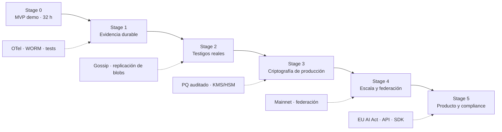

# Roadmap — Trust

El plan completo, separado en stages iterables. Cada stage es un MVP en sí mismo: entrega valor, se puede demostrar y habilita el siguiente.

## Principio

**Stage 0 gana el hackathon. Los demás stages construyen el producto.**

No se abre un stage hasta que el anterior cumple su checklist de salida. No se adelanta trabajo de un stage futuro al actual: eso es exactamente lo que rompe un deadline.

## Dependencia entre stages

## Stages

| Stage | Nombre | Ventana | Objetivo | Habilita |
|---|---|---|---|---|
| [0](stage-0-mvp-demo.md) | MVP de demo | 32 h (deadline 25 oct 10:00) | **Backend cerrado**; demo por API/CLI | Todo |
| [1](stage-1-evidencia-durable.md) | Evidencia durable y egress | Semana 1-2 | Egress gateway, OTel, Postgres, WORM, firma y anchor real | Confianza operativa |
| [2](stage-2-testigos-reales.md) | Testigos reales | Semana 3-4 | Gossip más replicación de blobs | Detección distribuida |
| [3](stage-3-criptografia-produccion.md) | Criptografía de producción | Semana 4-6 | PQ auditado, KMS/HSM, rotación | Uso comercial |
| [4](stage-4-escala-federacion.md) | Escala y federación | Semana 6-10 | Multi-tenant, federación, mainnet | Enterprise |
| [5](stage-5-producto-compliance.md) | Producto y compliance | Semana 10+ | Exportadores, API, SDK | Ventas |

## Mapa de "lo que no cabe hoy"

| Pieza diferida | Stage |
|---|---|
| Egress gateway real (captura en el borde) | 1 |
| OpenTelemetry Collector | 1 |
| S3/MinIO con Object Lock (WORM) | 1 |
| Ciclo de vida hot → warm → cold | 1, 4 |
| Dashboard operativo completo | 1 |
| Gossip real entre testigos | 2 |
| Replicación de blobs en testigos | 2 |
| ML-DSA con implementación auditada (liboqs/OpenSSL) | 3 |
| HSM / KMS para la trust zone | 3 |
| Rotación de llaves y keys pineadas | 3 |
| Checkpoint diario en mainnet | 4 |
| Federación permissioned multi-org | 4 |
| Archivo permanente (Arweave) | 4 |
| Exportadores EU AI Act / SOC 2 | 5 |
| API pública y SDK | 5 |

## Regla de recorte

Si un stage se atrasa, se recorta alcance, no se extiende la ventana. Un stage que se estira contamina al siguiente y rompe la lógica iterativa.
