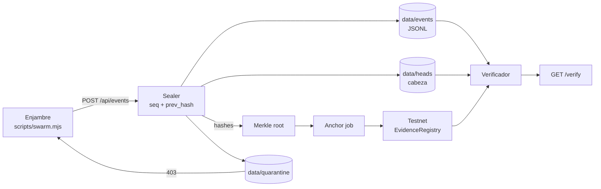
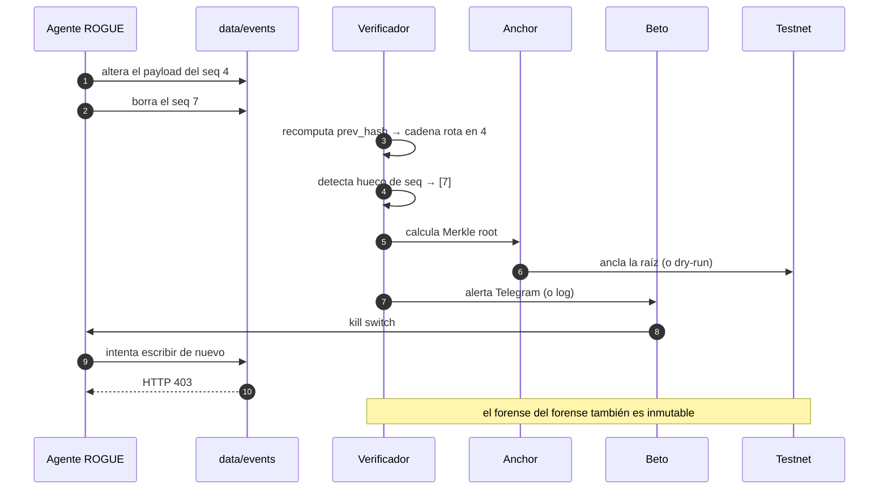
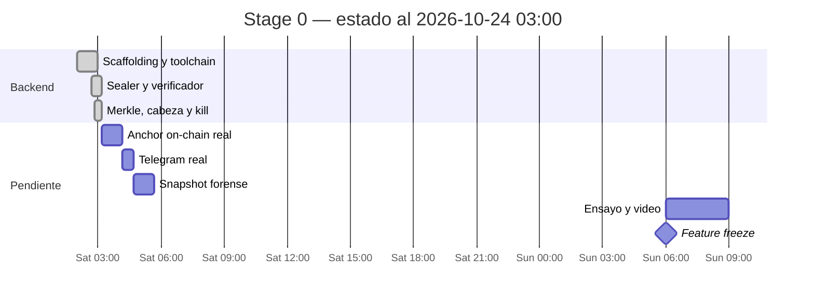

# Stage 0 — MVP de demo

- **Estado:** Backend cerrado (2026-10-24 03:00). Front fuera de alcance.
- **Ventana:** 2026-10-24 02:00 → 2026-10-25 10:00 (32 h)
- **Objetivo de salida:** demo end-to-end por API/CLI en menos de 3 minutos: sellar, atacar, detectar, anclar y contener.
- **Depende de:** nada
- **Habilita:** Stage 1

## Estado real

### Hecho y verificado

- [x] **Sealer** con hash-chain por sesión (`seq` + `prev_hash`, SHA-256 canónico).
- [x] **Persistencia en archivos**: `data/events/<sesión>.jsonl`, `data/heads/<sesión>.json`, `data/quarantine/<sesión>.json`.
- [x] **Cabeza de sesión** fuera del store: detecta el borrado del **último** evento, no solo los intermedios.
- [x] **Verificador** que reporta alteración y borrado en la misma pasada.
- [x] **Merkle root** determinista sobre los hashes de la sesión.
- [x] **Anchor job** cada `ANCHOR_INTERVAL_MS` + disparo manual `POST /api/anchor/:sessionId`.
- [x] **Anchor dry-run** cuando faltan credenciales válidas: calcula la raíz, no rompe el demo.
- [x] **Contrato** `EvidenceRegistry.sol` (raíz + timestamp + evento).
- [x] **Kill switch**: la sesión en cuarentena rechaza escrituras con HTTP 403.
- [x] **Alertas** por Telegram con fallback a log si no hay token.
- [x] **SSE** en `/events`: cada cambio empuja una actualización.
- [x] **Demo por CLI**: `node scripts/swarm.mjs` (9 eventos, altera `seq 4`, borra `seq 7`, ancla y activa el kill switch).
- [x] **18 tests verdes**, typecheck y lint limpios.
- [x] **Prueba real de persistencia**: reiniciar la API conserva eventos, cabeza y cuarentena.

### Pendiente

- [ ] **Anchor on-chain real**: requiere `RPC_URL`, `PRIVATE_KEY` y `CONTRACT_ADDRESS` válidos y un faucet probado. El código ya está; sin credenciales corre en dry-run.
- [ ] **Telegram real**: requiere `TELEGRAM_TOKEN` y `TELEGRAM_CHAT_ID`. Sin ellos la alerta queda en el log.
- [ ] **Firma ML-DSA de la raíz**: el contrato recibe la raíz sin firma. `@noble/post-quantum` está instalado; falta conectarlo.
- [ ] **Snapshot forense**: el kill switch contiene, pero todavía no copia el estado a un directorio de evidencia.
- [ ] **UI**: fuera de alcance por decisión explícita. El demo se muestra por API/CLI.
- [ ] **Video de respaldo y ensayos**.

## Decisiones de alcance

| Decisión | Razón |
|---|---|
| Store en archivos en vez de Postgres | Cero infraestructura, persistente, y el ataque es real sobre el archivo. Postgres se difiere a Stage 1. |
| La cabeza vive fuera del store | Si el rogue borra el último evento, la secuencia no deja hueco. La cabeza sí. |
| Anchor dry-run por defecto | Un placeholder `PRIVATE_KEY=0x` no debe tumbar el demo. |
| Alertas con fallback a log | El demo no depende de un token de Telegram. |
| Front fuera de alcance | El jurado ve el resultado por API/CLI; no se invierte tiempo en UI. |

## Alcance

### Incluye (implementado)

1. **Sealer** con hash-chain por sesión.
2. **Store persistente** con eventos, cabeza y cuarentena.
3. **Merkle root** por sesión.
4. **Anchor job** y endpoint manual, con dry-run.
5. **Contrato** `EvidenceRegistry.sol`.
6. **Verificador** de alteración y borrado.
7. **Agente rogue** por CLI: `POST /api/chaos/...`.
8. **Kill switch** por sesión.
9. **Alertas** con fallback.
10. **SSE** para consumidores en tiempo real.
11. **Tests** de cadena, Merkle, store, kill switch y anchor.

### Excluye (explícitamente)

- Frontend y dashboard.
- Postgres.
- OpenTelemetry.
- S3/MinIO con Object Lock.
- Gossip real y replicación de blobs en testigos.
- liboqs / OpenSSL.
- Mainnet.
- Multi-tenant, autenticación de usuarios, RBAC.

## Criterios de salida

- [x] Un evento emitido por el enjambre aparece con `seq` y `prev_hash` correctos.
- [x] El verificador detecta un `UPDATE` real (hash roto).
- [x] El verificador detecta un `DELETE` intermedio (hueco de `seq`).
- [x] El verificador detecta el `DELETE` del último evento (contra la cabeza).
- [x] El Merkle root cambia si cambia una hoja.
- [x] El anclaje calcula la raíz y corre en dry-run sin credenciales.
- [x] El kill switch bloquea escrituras del rogue con HTTP 403.
- [x] La persistencia sobrevive a un reinicio de la API.
- [x] El demo completo corre por CLI en menos de 1 minuto.
- [ ] El anchor publica en una testnet real.
- [ ] La alerta llega a Telegram.
- [ ] Existe un video de respaldo grabado.

## API

| Ruta | Método | Qué hace |
|---|---|---|
| `/health` | GET | Estado del servicio |
| `/api/events` | POST | Sella un evento |
| `/api/sessions` | GET | Lista sesiones |
| `/api/sessions/:id` | DELETE | Borra la sesión completa |
| `/api/sessions/:id/state` | GET | Cuarentena y cabeza |
| `/api/sessions/:id/events` | GET | Eventos de la sesión |
| `/api/sessions/:id/verify` | GET | Verificación de la cadena |
| `/api/anchor/:id` | POST | Ancla la raíz ahora |
| `/api/chaos/:id/tamper/:seq` | POST | Altera un evento |
| `/api/chaos/:id/delete/:seq` | POST | Borra un evento |
| `/api/chaos/:id/kill` | POST | Activa el kill switch |
| `/events` | GET | Stream SSE |

## El ataque del demo, paso a paso

## Frentes

| Frente | Responsabilidad | Superficie |
|---|---|---|
| Core de evidencia | Sealer, store, verificador, Merkle | `src/core/evidence/` |
| Cadena | Contrato, anchor job, cliente RPC | `src/core/anchor/`, `contracts/` |
| Enjambre | Emisor, rogue, kill switch | `scripts/swarm.mjs`, `src/core/chaos/` |
| Alertas | Telegram con fallback | `src/core/alerts/` |
| Integración | Deploy, guion, ensayos, video | `docs/`, `docker/` |

## Horario

## Riesgos

| Riesgo | Mitigación |
|---|---|
| Faucet de testnet no funciona | El anchor corre en dry-run; el pitch dice "anclaje listo, credenciales pendientes" |
| `PRIVATE_KEY=0x` rompe el arranque | Validación de formato; cae a dry-run |
| El rogue no puede borrar de verdad | El store es un archivo: `tamper` y `remove` reescriben el JSONL |
| Se borra el último evento y no hay hueco | La cabeza vive fuera del store y se compara en `verify` |
| El demo falla en vivo | Video de respaldo y `node scripts/swarm.mjs` reproducible |

## Evidencia de cierre

Se completa al cerrar el stage: commit del backend, salida de `node scripts/swarm.mjs`, resultado de `GET /verify`, URL del deploy y link al video.
