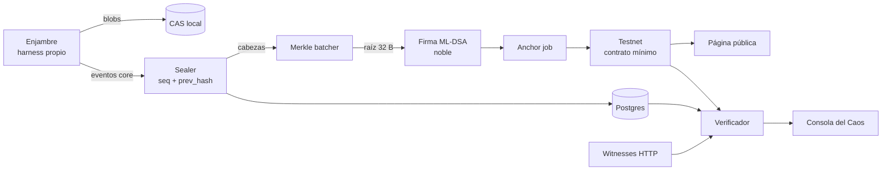
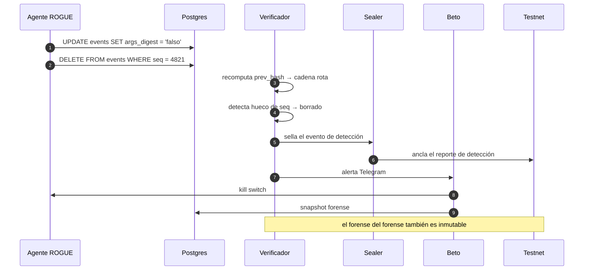
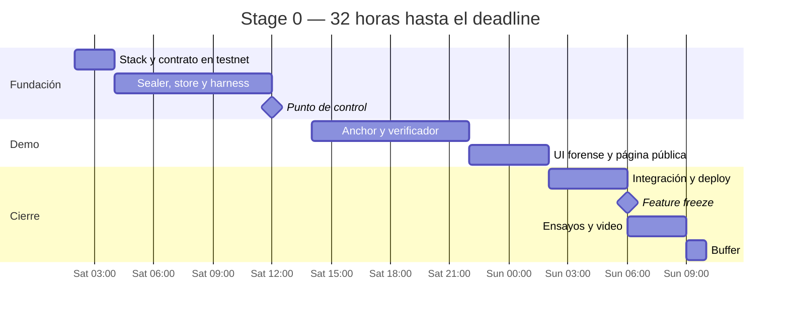

# Stage 0 — MVP de demo

- **Estado:** En curso
- **Ventana:** 2026-10-24 02:00 → 2026-10-25 10:00 (32 h)
- **Objetivo de salida:** una demo end-to-end de menos de 3 minutos, reproducible, que muestre los cuatro momentos de la Consola del Caos sin intervención manual.
- **Depende de:** nada
- **Habilita:** Stage 1

## Alcance

### Incluye

1. **Harness propio** que intercepta tool calls del enjambre y emite eventos core.
2. **Sealer** con hash-chain por sesión (`seq` + `prev_hash`) y escritura a Postgres más CAS local.
3. **Merkle batcher** que agrega cabezas cada N segundos.
4. **Firma ML-DSA** de la raíz con `@noble/post-quantum`.
5. **Contrato mínimo** en una testnet: raíces, timestamp, evento.
6. **Anchor job** que publica la raíz.
7. **Verificador** que recomputa hashes, detecta `prev_hash` roto y huecos de `seq`.
8. **Consola del Caos:** enjambre, alertas y panel forense.
9. **Página pública de verificación** que lee el contrato con un RPC público.
10. **Agente rogue** con credenciales reales de escritura que ejecuta `UPDATE` y `DELETE` contra el store.
11. **Kill switch** y snapshot forense.
12. **Alerta por Telegram**.

### Excluye (explícitamente)

- OpenTelemetry.
- S3/MinIO con Object Lock.
- Gossip real y replicación de blobs en testigos.
- liboqs / OpenSSL.
- Mainnet (salvo que se pruebe antes del sábado 12:00).
- Dashboard completo, métricas históricas, filtros avanzados.
- Multi-tenant, autenticación de usuarios, RBAC.

## Criterios de salida

- [ ] Un evento emitido por el harness aparece en Postgres con `seq` y `prev_hash` correctos.
- [ ] El batcher produce una raíz y el anchor job la publica en testnet.
- [ ] El verificador detecta un `UPDATE` real hecho por el rogue (hash roto).
- [ ] El verificador detecta un `DELETE` real hecho por el rogue (hueco de `seq`).
- [ ] La detección se muestra en el panel forense en menos de 5 segundos.
- [ ] La página pública verifica un reporte contra la raíz anclada sin credenciales.
- [ ] El kill switch detiene al rogue y el snapshot preserva el estado.
- [ ] La alerta llega a Telegram.
- [ ] El demo completo corre en menos de 3 minutos, cinco veces seguidas, sin pasos manuales ocultos.
- [ ] Existe un video de respaldo grabado.

## El ataque del demo, paso a paso

## Frentes

| Frente | Responsabilidad | Superficie |
|---|---|---|
| Core de evidencia | Sealer, store, CAS, verificador | `packages/core` |
| Cadena | Contrato, anchor job, cliente RPC | `packages/chain`, `contracts/` |
| Enjambre | Harness, agentes, rogue, kill switch | `packages/swarm` |
| UI | Consola del Caos, panel forense, página pública | `apps/web` |
| Integración | Deploy, Telegram, guion, ensayos, video | `ops/`, `docs/` |

Regla de integración: **el frente de Integración no escribe features.** Su trabajo es que los otros cuatro se vean bien juntos.

## Horario

| Hora | Hito |
|---|---|
| Sáb 02:00-04:00 | Stack confirmado, repo inicializado, contrato desplegado en testnet, faucet probado |
| Sáb 04:00-12:00 | Sealer, store, harness y batcher funcionando con eventos reales |
| Sáb 12:00-14:00 | Punto de control: si el sealer no sella, se recorta alcance, no se extiende el horario |
| Sáb 14:00-22:00 | Anchor job, verificador, rogue y kill switch |
| Sáb 22:00-02:00 | UI forense y página pública |
| Dom 02:00-06:00 | Integración end-to-end, Telegram, deploy |
| **Dom 06:00** | **Feature freeze. No se escribe código nuevo.** |
| Dom 06:00-09:00 | Ensayos, video de respaldo, pitch, Q&A |
| Dom 09:00-10:00 | Buffer. Nada nuevo. |

## Riesgos

| Riesgo | Mitigación |
|---|---|
| Faucet de testnet no funciona | Probar antes del sábado 04:00; fallback a Base Sepolia o Anvil local |
| Vercel no puede acceder al repo de la org | Configurar mirror a repo personal antes del sábado 12:00 |
| El rogue no puede borrar de verdad (ORM/cache) | Usar SQL directo contra Postgres; verificar el `DELETE` con `SELECT count` |
| El anclaje mainnet no se prueba | Eliminarlo del pitch el sábado 12:00 |
| El demo falla en vivo | Video de respaldo grabado el domingo a las 07:00 |

## Evidencia de cierre

Se completa al cerrar el stage: commit del feature freeze, URL del deploy, link al video, resultado de los cinco ensayos.
