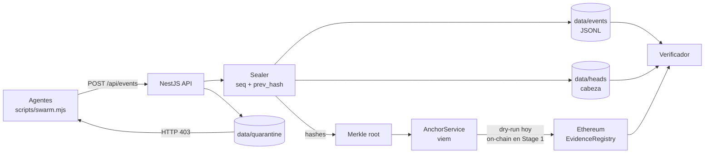
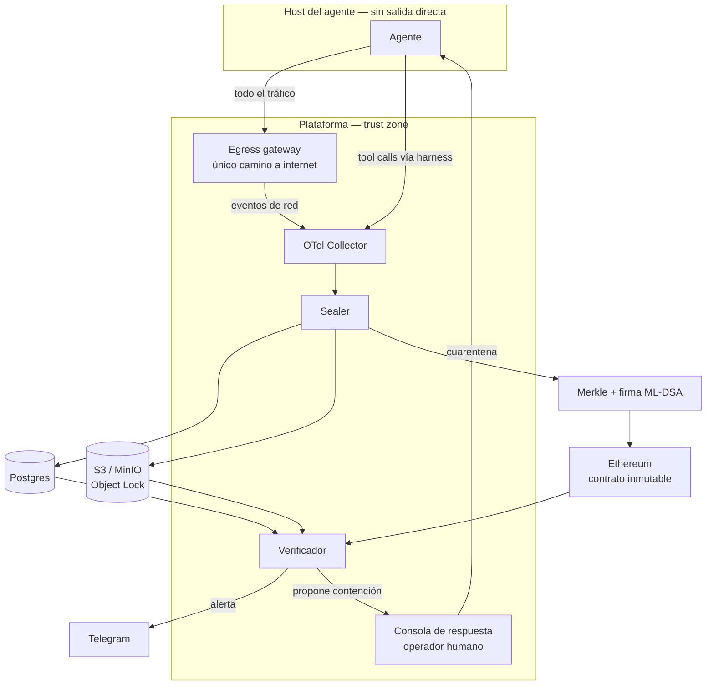

# Stage 1 — Evidencia durable y captura en el borde

- **Estado:** Pendiente
- **Ventana:** Semana 1-2 post-hackathon
- **Objetivo de salida:** la captura ocurre fuera del agente y en el borde de red, la evidencia sobrevive a la pérdida del disco, y el anclaje es real y verificable por terceros.
- **Depende de:** Stage 0 (backend cerrado)
- **Habilita:** Stage 2

## Lo que hereda del Stage 0

El backend del Stage 0 ya demuestra el ciclo completo por API/CLI: sellar, atacar, detectar, anclar en dry-run y contener.

### Qué garantiza hoy

| Propiedad | Estado | Nota |
|---|---|---|
| **Integridad** | Sí | Alteración y borrado se detectan, incluido el último evento contra la cabeza |
| **Disponibilidad** | Best-effort | Si el proceso cae, la evidencia en archivo sobrevive; el ataque de red no está cubierto |
| **Veracidad** | Parcial | La captura ocurre en la API, no en el borde de red |
| **Anclaje real** | No | El contrato existe, pero el demo corre en dry-run |

## Modelo de amenaza

### "Proxy" no significa lo mismo en todas partes

| Término | Qué es | ¿Lo usamos? |
|---|---|---|
| **RPC proxy** | Nodo que transporta lecturas y escrituras hacia Ethereum (Infura, Alchemy, publicnode) | Sí, es el mensajero |
| **Proxy de contrato** | Contrato *upgradeable* que delega en otro y alguien puede reemplazar | **No.** El contrato es inmutable |
| **Egress gateway** | Punto donde se captura el tráfico de red del agente | Todavía no. Es el objetivo central de este stage |

### El contrato no lo puede alterar el agente

1. **No tiene función de upgrade.** No hay `upgradeTo`, no hay admin que cambie la lógica.
2. **Escribir requiere la llave de la wallet.** Esa llave vive en la trust zone, fuera del agente.
3. **Una transacción minada no se borra.** El agente podría añadir otra raíz, pero la anterior queda en el histórico. Borrarla exige reescribir un bloque: ataque del 51% de Ethereum.

### El RPC es un mensajero, no el dueño

El RPC puede **mentir al leer** o **censurar una transacción**. No puede cambiar el contrato ni borrar un bloque.

- **Mentira de lectura:** se mitiga consultando al menos dos RPC y, en producción, un nodo propio. La verdad está en la cadena.
- **Censura de escritura:** se mitiga con reintentos y RPC alternativos. Si el anclaje se detiene, la alarma de heartbeat lo detecta.

### El agente y el egress gateway

**Asumimos que el agente sabe que el gateway existe.** La seguridad no puede depender de que lo ignore.

La garantía es estructural:

- El gateway corre **fuera del contenedor del agente**, en la plataforma.
- Es el **único camino de salida** a internet; el agente no tiene salida directa.
- El agente **no tiene credenciales** para desactivarlo.
- Todo el tráfico se registra en el borde, antes de que el agente pueda tocarlo.

Si el agente tuviera `root` en el mismo host que el gateway, podría matarlo. Por eso el agente y la trust zone viven en hosts separados. Si lo mata, deja de haber evidencia nueva: **el hueco de anclaje se nota**.

### Quién activa el kill switch

**Un humano. Nunca el agente.**

- **Cuarentena automática:** el verificador puede aislar una sesión al detectar manipulación.
- **Apagado definitivo:** lo confirma el operador (Beto, seguridad) desde la consola.
- **Por qué:** un falso positivo apagaría agentes legítimos. El sistema detecta y aísla; el humano decide.
- **Llave:** el agente no tiene forma de desactivar la cuarentena; sus escrituras reciben `403`.

## Alcance

### Incluye

1. **Egress gateway real** fuera del contenedor del agente: único egress, allowlist y logs en el borde.
2. **OpenTelemetry Collector** con exporters al sealer, reemplazando el harness propio.
3. **Postgres** como store de eventos, reemplazando los archivos JSONL.
4. **S3/MinIO con Object Lock (WORM)** y versionado para blobs.
5. **Ciclo de vida** hot (0-90 días) → warm (90 días-2 años) → cold.
6. **Snapshot forense** antes de cualquier contención: eventos, cabeza y cuarentena a un directorio inmutable.
7. **Firma ML-DSA de la raíz** con `@noble/post-quantum`, verificada por el verificador.
8. **Anchor on-chain real** en testnet: contrato inmutable, wallet en la trust zone, faucet probado.
9. **Métricas de anclaje:** heartbeat, latencia, raíces pendientes, fallos de RPC.
10. **Alarma de anclaje detenido:** si no hay raíz nueva en dos intervalos, alerta.
11. **Tests de integración** del sealer, batcher y verificador: alteración, borrado, reordenamiento, duplicado.

### Excluye

- Gossip real entre testigos (Stage 2).
- Federación multi-organización (Stage 4).
- PQ de producción con implementación auditada (Stage 3).

## Arquitectura objetivo

## Criterios de salida

- [ ] Todo el tráfico del agente pasa por el egress gateway; una conexión directa falla.
- [ ] Un evento de red capturado en el borde llega al sealer con el mismo schema que un tool call.
- [ ] Un blob borrado del store no rompe la verificación (el hueco es evidencia).
- [ ] Object Lock impide borrar un objeto dentro de la retención (probado).
- [ ] Postgres reemplaza los archivos sin cambiar el schema de eventos.
- [ ] El snapshot se crea antes de la contención y su manifiesto de hashes coincide.
- [ ] La firma ML-DSA se verifica y una firma inválida se rechaza.
- [ ] El anchor publica en testnet y un tercero verifica la raíz con un RPC público.
- [ ] La alarma de anclaje detenido se dispara en una prueba controlada.
- [ ] La suite de integración cubre alteración, borrado, reordenamiento y duplicado.

## Riesgos

| Riesgo | Mitigación |
|---|---|
| El agente evade el egress gateway (túnel, DNS) | Sin salida directa, allowlist y bloqueo de DNS externo |
| El agente tiene `root` en el host del gateway | Separar hosts; el gateway no comparte kernel con el agente |
| El RPC miente o censura | Dos RPC, nodo propio en producción, alarma de heartbeat |
| Object Lock en modo compliance impide operar | Governance mode en desarrollo; compliance solo en producción |
| OTel añade latencia o pierde eventos | Cola durable y comparación de conteos emitidos vs sellados |
| El contrato se despliega con proxy upgradeable | Revisar el bytecode; prohibido `upgradeTo` |
| El costo de storage crece sin control | Dedup por hash y lifecycle desde el día uno |

## Decisiones pendientes

- Confirmar que el contrato final no sea upgradeable.
- Elegir el proveedor de RPC primario y el secundario.
- Definir la allowlist de egress del agente.
- Decidir si la cuarentena automática requiere confirmación humana o solo notificación.
